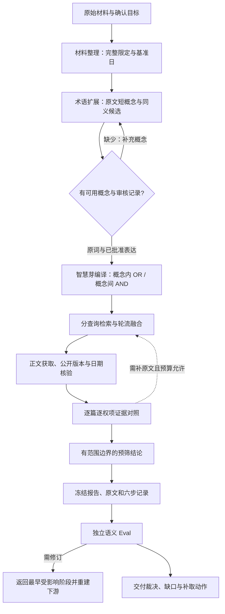

# 专利新颖性预筛

**版本 2.6.0**。将确认后的技术要素转成适合智慧芽的概念查询，取得正文，逐篇核对完整限定，再交付有明确证据范围的预筛报告。

当前代码、历史材料和本轮测试各有独立入口：

| 入口 | 内容 |
|---|---|
| [正式业务 Skill](.agents/skills/patent-precheck/SKILL.md) | 一个主入口、六个业务阶段、独立语义 Eval |
| [智慧芽查询协议](docs/patsnap-search.md) | 短概念、同义表达、查询预算、融合与实际下发记录 |
| [测试与 RSI](docs/testing.md) | 分开验证检索、固定正文判断、独立 Eval、临时 Skill 增益 |
| [final_test](final_test/README.md) | 本轮实际测试结果及未执行项目；原始数据只留本地 |
| [history](history/README.md) | 旧 README、版本文档、报告、诊断入口、历史回归与本地运行产物 |

## 运行

在项目根目录用 PowerShell 执行。已有虚拟环境可继续使用：

```powershell
py -3.12 -m venv .venv-novelty
.\.venv-novelty\Scripts\python.exe -m pip install -r requirements.txt
.\start_novelty.ps1
```

首次配置可将 `.env.example` 另存为 `.env`，填入 `LLM_API_KEY`、`LLM_BASE_URL`、`LLM_MODEL`。已有 `.env` 保留。`PATENT_PLATFORM_MCP_CONFIG` 指向现有智慧芽 `patent-platform` MCP 配置；默认读取当前用户 `Downloads/mcp.json`。不把密钥写进查询、结果或 Git。

网页确认技术要素、基准日、术语审核和外发范围后运行。长权项先生成短概念锚点；不能直接把整段权项交给智慧芽做短语检索。已有宿主复核可使用 `tools/run_host_agent.py prepare/finish`，仍按模型意见标识。

## 业务流程

| 阶段 | 实际交付 |
|---|---|
| [材料整理](.agents/skills/patent-material-preparation/SKILL.md) | 带出处的要素、关系、否定、参数、版本和基准日；未读材料保持未知 |
| [术语扩展](.agents/skills/patent-synonym-expansion/SKILL.md) | 连续原文短概念 `anchors`、同义候选、审核状态；完整权项保留 |
| [候选检索](.agents/skills/patent-candidate-search/SKILL.md) | 实际下发查询、平台返回、融合排名、正文获取、日期资格和扩展词归因 |
| [证据对照](.agents/skills/patent-evidence-alignment/SKILL.md) | 逐篇逐项重合、原文定位、关键差异、同一方案及未解决缺口 |
| [新颖性判断](.agents/skills/patent-novelty-assessment/SKILL.md) | 每个目标分别判断；不跨篇或跨互斥实施例拼成完整披露 |
| [报告交付](.agents/skills/patent-report-delivery/SKILL.md) | 一致的 Markdown / JSON、原文指纹及冻结的六步 `skill_records` |
| [独立语义 Eval](.agents/skills/patent-semantic-eval/SKILL.md) | 冻结后再读独立参考，逐技能六维文字裁决及跨阶段核验 |



## 智慧芽术语扩展

例如用户材料中的“永磁同步电机驱动离心叶轮”，经审核确认英文译名后，可以生成：

```text
TACD:(("永磁同步电机" OR "permanent magnet synchronous motor") AND "离心叶轮")
```

OR 只表示同一概念的不同表达；不同部件、材料或机制分组组合。原词查询先发送，新增表达按预算进入独立查询；聚焦回退每次仅放宽一个概念。平台每条返回最多25篇，正文预算单独计数，失败也占尝试次数。多查询按轮次融合，避免第一条大查询独占正文名额。没有合格短概念的长权项明确报缺口，不切碎字符凑查询。

新同义词只进入查询，不改写目标权项、不写入披露判断词典。生成候选不等于审核完成；审核完成也不等于已发出。`expansion_attribution` 记录候选到实际查询和新增文献的链路，预算未覆盖的表达另列原因。

## 测试与结果解释

```powershell
# 当前和历史工程回归分开列出，结果放在 final_test 的新运行目录
.\.venv-novelty\Scripts\python.exe -X utf8 tools/run_verification.py --output-dir final_test/engineering-new
# 汇总本轮工程检查；交接包只在本地导入，另生成固定正文与独立Eval预览
.\.venv-novelty\Scripts\python.exe -X utf8 tools/run_final_test.py --handover <交接包.zip> --output-dir final_test/run-new
```

工程通过只证明程序契约。真实检索召回、固定正文的证据判断、独立语义 Eval 和 RSI 增益分别记录；未执行或无独立复核时保持空值，不填零、不称验收通过。三模型各标一批不等于三模型共识；名单外文献标为未判。同一申请的不同公布文本不计作多个独立样本。

RSI 只修改临时的术语扩展指令。查询编译、融合、预算和评分固定；提议在试跑前封存，不读取测试题、金标、参考引文或逐轮测试反馈。v1.2 的 **35/45/20** 原规则保留。当前 Copy-A 已用于诊断，应作为开发案例；泛化结论须另外使用封存案例。详见[测试协议与闭环](docs/testing.md)。

## 文件位置

```text
.agents/skills/    正式 Skill 与必要上下文
modules/          当前业务、智慧芽编译、证据判断与独立评分
tools/            当前运行、诊断、数据准备和测试入口
tests/            当前离线回归；构造数据不冒称真实模型判断
docs/             当前流程和协议
evals/testsets/    仍被当前评分器使用的固定契约数据
final_test/       本轮测试、数据审计、预览和状态索引
history/          历史代码、文档、报告及旧运行归档
.local/cases/     当前真实案件；原始材料与旧轮次不覆盖
```

实际调用仍需的旧快照解析代码保留在 `modules/`，用于读取历史来源；在线检索入口统一使用智慧芽。历史报告保留其真实来源。真实案件、原始金标、凭据和大体积运行产物不进入 Git。更多操作见[上下文协议](docs/skill-contexts.md)、[变更记录](CHANGELOG.md)。
