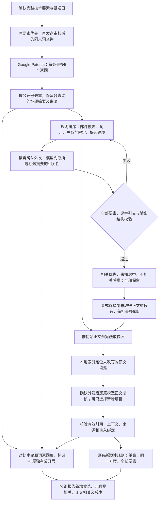

> 当前1.0.0架构与语义eval见[六个业务skill与独立评估](semantic-skills.md)。下文记录此前版本设计及工程兼容基线；数值指标不作为当前语义验收。

# 候选排序、相关文献补取与增量判断

0.5.0 先改善阅读顺序，再核查新文献是否真的相关。规则排序、模型标题/摘要判断和正文逐项复核分开记录。资料仍限 Google Patents，CN 新颖性判断不跨文献或互斥实施例拼接。



## 排序具体改变了什么

原词汇提示会把“部件名都出现、却没有对应技术关系”的文献排得很高。当前规则以部件覆盖50%、归一化词汇分数30%、关系线索20%为基线，再对明确的仅目录/索引提及、反向控制/驱动、否定或单值数值冲突施加降分。每篇保留分项、所用摘要位置、旧词汇分数和旧排名。

只识别有限关系模式，分数不是概率。不同查询可能返回不同摘要，全部保留，取其中最强规则线索用于排序。术语先用可信词典归一化，已审核LLM别名仅作查询/排序提示，不加入法律等同或证据嵌入词典。不能仅因出现“背景”就降分；目录/索引本身是目标技术时也不套用提及惩罚。

列明的Pa/kPa/MPa、W/mW/MW、m/cm/mm、Hz/kHz/MHz、°C和百分数可作单值精确换算，单位大小写保留。范围、不等式和未覆盖的单位不作机械冲突判断。规则不理解所有术语、复杂句法或多个数值的对应对象；存在疑点时仍须正文复核。低分和未知候选不删除。

## 模型相关性判断与补取正文

展开“改善候选排序与补充相关文献”：

1. 先查看规则线索；需要时选择候选，预览外发的技术要素和标题/摘要，确认后点击“模型判断候选相关性并重新排序”。单批最多20篇、80个要素与文献的组合、4万字符；超限拒绝，不截断。
2. 模型对全部要素返回支持/部分支持/矛盾/未知及指定摘要中的逐字引文。程序校验完整性、引用和重复/遗漏；整批无效时回退规则，记录失败和成本。相关优先、未知及未判断居中、不相关后排，全部候选仍可查看。
3. 选择未取得正文的候选，点击“补充所选文献正文”。仅读取本轮已有的Google Patents候选，不重新搜索；每批最多5篇、累计20篇。记录每次尝试和失败，追加快照并保留此前有效复核。
4. 第3步选择新增文献，调用正文逐项复核。文献选择只决定下次发送范围，不删除其他有效记录。失败清除本次选择的旧复核，其他有效风险依据保留；更改要素、日期、对应原文或模型设置后，相应复核绑定失效。

模型元数据记录使用 `model_metadata` 来源，保存模型、服务主机、提示词版本、时刻、输入哈希与输出记录哈希。它不生成 `DocumentReview`。正文相关性必须来自哈希有效、带原文位置和说明的逐项复核；模型来源不改名为人工确认。两类调用都需页面明确确认外发，规则排序和离线比较不调用模型。

## 怎样算“新增相关文献”

比较本轮全部成功原要素查询返回集与扩展查询返回集，按公开号判断增量。同一文献被更多查询命中不算新增；不同公开号也不等于不同专利族。

| 报告项 | 含义 |
|---|---|
| 扩展独有候选 | 扩展返回、原词未返回的公开号，尚不能证明相关 |
| 元数据判为相关 | 模型在标题/摘要中找到相关线索，尚待正文验证 |
| 正文复核判为相关 | 当前输入绑定有效的逐项复核认为正文相关，保留来源与依据 |
| 可归因的正文相关增量 | 原词查询逐要素全部成功且来源有效时，上述正文相关的扩展独有公开号 |
| 未读、未复核或失效 | 一律未知，不按不相关填充 |

原词请求失败、超预算、超长、用户自定义范围或旧记录不完整时，不能确认扩展增量归因。报告保留观察到的扩展独有候选并提示边界。“正文相关”也不等于全部要素在同一方案完整披露；后者仍由原有规则决定。模型相关判断是运行结果，不能反过来充当同一模型的独立金标准。

成本分别记录扩展查询数、追加页面尝试/成功数、模型调用/HTTP尝试及实际返回用量；无新增正文相关文献时，每篇增量查询成本不可计算，不填0。

## 如何验证排序和召回

```powershell
.\.venv-novelty\Scripts\python.exe -X utf8 tools/run_synonym_eval.py --k 3 --compare-rankers
```

每次输出到新目录。`evaluation.json/md` 比较四种扩展方案；`ranking_comparison.json/md` 在每组相同查询、相同候选和相同成本下比较旧词汇排序与新规则排序。逐组保留Recall@K、Precision@K、TopK公开号、新增相关/不相关公开号及新增相关@K；金标准不输入排序器。缺基线或独立参考时，相应增量不可计算。

原“扩展增加噪声”合成案例保留原标签与候选。旧排序的Recall@3为50%、Precision@3为33.3%；新排序分别为100%和66.7%，但新增相关文献仍为0。这说明阅读顺序恢复，不能声称找到了新的相关文献。其他合成案例检查真实的固定池相关增量，仍不代表Google全库召回。

工程回归覆盖关系与同义词、单位大小写、误引/遗漏/失败、未知保留、追加正文以及原有效风险保留。真实质量评估需冻结真实Google结果、独立专业标注、专利族隔离和未调参的测试集，不能用模拟响应或模型自评替代。

实现：`modules/candidate_ranking.py`、`modules/candidate_relevance.py`、`modules/candidate_ui.py`。回归：`tests/test_candidate_relevance.py`、`tests/test_candidate_ui.py`、`tests/test_ranking_evaluation.py`。

本轮验证：181项自动化测试、34条原有基础eval（20/20、10/10、4/4）和3份变更技能静态校验通过；4道合成池保留固定查询及成本作旧新对照。模型行为以模拟响应验证，未调用新的付费API或开展真实Google质量盲测。
