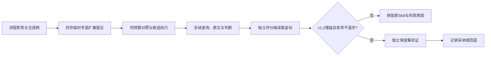

# 测试协议与闭环

每轮使用 `final_test/` 下的新目录，不覆盖旧结果。本轮汇总见 [final_test](../final_test/README.md)。各类测试分别记录执行状态、来源、指纹与结论。

| 测试 | 输入 | 输出及限制 |
|---|---|---|
| 工程回归 | 构造数据、固定历史夹具、模拟模型 | 契约通过/失败；不等于专业判断准确率 |
| 智慧芽检索 | 公开目标、术语审核、固定查询及正文预算 | 实际查询到返回、融合、正文、日期资格的损失；名单外未判 |
| 固定正文判断 | 公开目标、固定原文，不含答案 | 逐篇重合/差异/标签与两权项结论；不计算检索召回 |
| 独立语义 Eval | 冻结六步记录、原始依据、可选独立参考 | 六维文字裁决和跨阶段核验；未调用裁判不能写通过 |
| RSI | 封存临时提议、相同编译器/预算/数据、独立评分 | v1.2原35/45/20；增益只归因到术语扩展 |

## 先定位检索，再隔离证据判断

检索入口只接收公开input，没有金标参数。先预览已有审核扩展；需要重新生成时，独立请求核验候选等义，再冻结实际计划：

```powershell
python tools/run_retrieval_probe.py --input <public/input.json> --expansion <expansion.json> --output-dir final_test/retrieval-preview
python tools/run_retrieval_probe.py --input <public/input.json> --generate-terms --run-search --confirm-external --max-queries 8 --results-per-query 25 --max-documents 25 --output-dir final_test/retrieval-live
```

模型配置从进程环境变量读取。只有显式启用才调用模型和智慧芽；执行失败保留计划、实际下发、已取得正文及失败状态。执行结束再交`tools/evaluate_retrieval.py`离线读取金标诊断，不能把诊断名单回传盲测端。


智慧芽适配必须同时观察原词、已审核扩展、独立查询与融合，不用“前25没有金标”推断平台无该文献。已知公开号的可达性核验只用于诊断，不能给正式检索提供答案。更换平台先测原参考的可达性；新池化金标另取数据集ID，两版分数不直接比较。

三位模型分别标不同文献属于分工。至少为唯一high、方法差异和疑难边界安排交叉复核；记录实际模型、原始响应、分歧与裁决。标注应容许不相关与证据不足，不强迫所有候选成为正例。未判文献保持未判，加入新参考前冻结新版本，不能在同一轮边测边改答案。

固定正文预览与执行：

```powershell
python tools/run_fixed_corpus.py --input <public/input.json> --corpus <corpus.jsonl> --output-dir final_test/evidence-preview
# 核对公开材料和正文的外发范围，模型配置使用进程环境变量
python tools/run_fixed_corpus.py --input <public/input.json> --corpus <corpus.jsonl> --output-dir final_test/evidence-live --run-model --confirm-external
```

该入口没有 `--gold`，不联网检索；先冻结输入，执行后冻结 `predictions.json`。仅接收正文快照字段，拒绝夹带relevance或答案标签。原文完整性不由“文件有正文”推定。固定正文回放不能作为检索能力或RSI采纳依据。

随后使用 `tools/score_rsi_results.py`，再读取封存的 `private/gold.json` 和独立绑定的 `--reviews`。固定正文的检索分与总分保持 `null`，只观察证据、结论、误报/漏报和未判；没有独立复核时证据与结论分也保持空值。正式语义 Eval 使用 `tools/run_semantic_eval.py`，逐技能六维及跨阶段裁决保持文字协议。

## 术语扩展 RSI

1. 公开目标：只改 `patent-synonym-expansion` 的临时指令，保持完整权项；生成可用于智慧芽的连续原文概念，以及语境等义表达。
2. 固定条件：查询编译版本、融合策略、模型配置、查询次数、每条返回量、正文尝试预算、数据版本和评分规则。修改这些条件须另开实验。
3. 提议在试跑前封存。提议者只读正式Skill、流程职责和不相关的合成例；不能读取测试题、金标名单、参考引文、标签、分数或检索损失。评分端冻结业务输出后才读金标，评分请求不进入生成者对话。
4. 保存“候选词→审核→计划查询→实际下发→新增候选”的归因。没有实际查询变化不能采纳；仅发出了不同查询也不能证明有效。
5. 对照和候选在相同条件下配对运行，按v1.2原35/45/20评分。严格增益且各分项不退步、补齐独立复核、处理未判和名单外参考后才允许采纳。
6. 当前Copy-A是开发案例。另在未用于诊断/提议的独立案例上比较原Skill与入选Skill，报告案例级结果，不能把25篇相关文献当成25个独立测试案例。



参考可以进入本机独立评分端，不能进术语生成/提议请求。本机监听地址不证明后端数据留在本机；外部转发须单独记录实际目的地和外发范围。历史交接包中的代理只归档，不作为当前默认评分服务。
